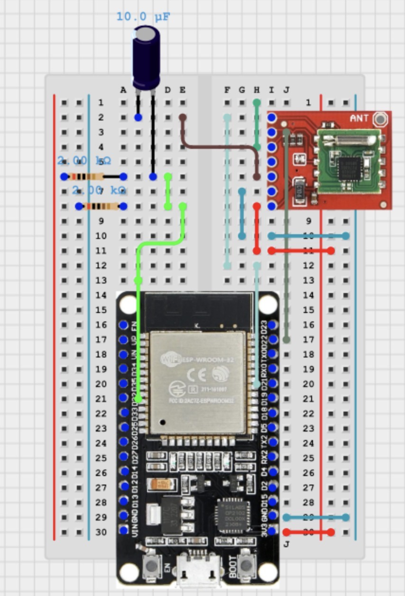
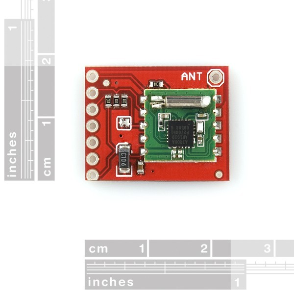
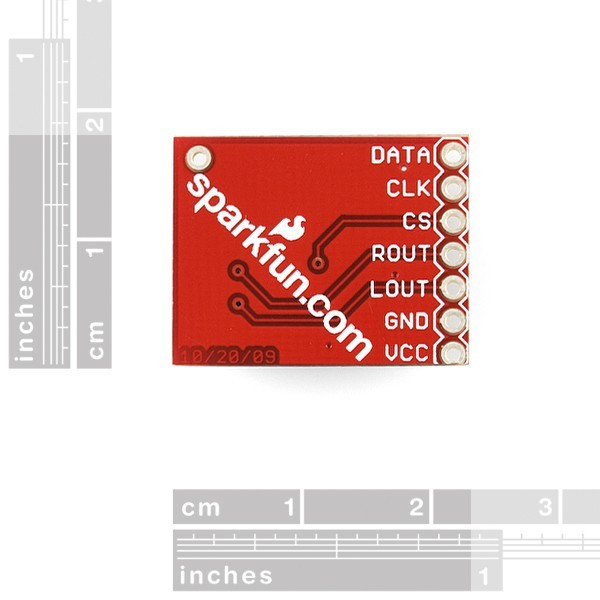

WARNING! THE Sparkfun AIROHA 1010 dev board has been discontinued! There are clones available on ebay that require additional wiring to work with this circuit design.


# Meet Ré! The FM Radio Streamer and Recorder! 📻✨

A diagnostic and interface firmware project written for the **ESP32-WROOM** development board to communicate with and control the legacy **SparkFun (2009) Airoha AR1010 FM Radio Receiver Breakout Board**. It acts as a Command Line Interface (CLI) tool while concurrently serving an interactive web application over Wi-Fi.



## 🚀 Features

- **Airoha 1010 Control Engine:** Implements low-level register control over the AR1010 FM receiver IC via I2C/SPI to manipulate tuning frequencies, volume control, and mute flags.
- **Hardware-Driven CLI:** Interactive terminal interface deployed directly over the ESP32 serial interface to debug, calibrate, and verify the AR1010 breakout board operations.
- **Interactive Web Interface:** A responsive local web server that broadcasts a live front-end portal over Wi-Fi.
- **Dynamic ADC Pin Selection:** An integrated drop-down menu on the web UI allowing users to dynamically switch active ADC paths (such as **GPIO 32**) to probe and analyze incoming analog audio byte captures.
- **In-Browser WAV Recording:** Record raw audio bytes streamed from the ADC natively within the browser, providing instant local `.wav` file downloads.
- **Low-Latency WebSocket Engine:** Features a dedicated (experimental) WebSocket infrastructure designed to stream real-time audio bytes straight from the hardware registers to the client dashboard *(Note: WebSocket streaming is currently untested)*.

---

## 🛠️ Hardware Requirements

- **Microcontroller:** ESP32-WROOM (32-bit Dual-Core Tensilica processor)
- **FM Receiver Breakout:** SparkFun (2009) Airoha AR1010 FM Radio Board
- **Visual References:** Refer to the hardware layout images included in this repository for specific board pin markings:
  - 
  - 

---

## 🔌 Wiring Configuration

Ensure your ESP32-WROOM development board is connected to the SparkFun breakout pins according to the following mapping layout:

| ESP32-WROOM Pin | SparkFun AR1010 Pin | Description |
| :--- | :--- | :--- |
| **GPIO 21 (SDA)** | SDA | I2C Data Line |
| **GPIO 22 (SCL)** | SCL | I2C Clock Line |
| **GPIO 32 (ADC1_CH4)** | AUDIO_OUT | Analog Audio Waveform Output |
| **3V3** | VCC | 3.3V Main Power Supply |
| **GND** | GND | Common Ground Line |

*Hardware Note: To ensure safe signal processing within the ESP32 internal ADC tolerances (0V - 3.3V), place a protective DC-blocking coupling capacitor inline with the audio path between the receiver out and GPIO 32.*

---

## 🔒 Security & Wi-Fi Configuration

To prevent exposing sensitive network information publicly on GitHub, Wi-Fi credentials are kept in a local configuration file that is ignored by Git. 

Before compiling, you must create a configuration header file containing your credentials in the appropriate directory (e.g., `include/secrets.h` or as defined by your macro imports):

```cpp
// Example layout for your local secrets file
#ifndef SECRETS_H
#define SECRETS_H

const char* WIFI_SSID = "Your_WiFi_Name";
const char* WIFI_PASS = "Your_WiFi_Password";

#endif
```

*Note: Ensure your secret filename matches the layout used in `src/` and is safely tracked in your `.gitignore` file before making any public forks.*

---

## ⚙️ Quick Start & Environment Configuration

This project is built and optimized for compilation using the **PlatformIO** ecosystem.

1. **Clone the Repository Locally:**
   ```bash
   git clone https://github.com/TangoRomeoEchoNovemberTango/AirohaAR1010DiagTool.git
   cd AirohaAR1010DiagTool
   ```

2. **Setup Local Credentials:**
   - Create your local secrets file using the format provided in the **Security** section above.

3. **Open the Environment:**
   - Launch Visual Studio Code (VS Code) and open the project directory.
   - PlatformIO will automatically identify the `platformio.ini` specification file and fetch dependencies.

4. **Deploy Firmware:**
   - Connect the ESP32-WROOM via USB.
   - Run the PlatformIO Build & Upload target (`Ctrl+Alt+U` or `Cmd+Shift+P` -> `PlatformIO: Upload`).

---

## 📊 Software Operation

1. **CLI Mode:** Open a serial terminal monitor set to the project's default baud rate to explicitly test hardware registers, trigger diagnostic routines, and confirm structural connectivity.
2. **Web Framework Mode:** Monitor the serial output upon boot to identify the dynamic or static local IP address assigned to the ESP32 by your Wi-Fi access point.
3. **Audio Handling:** Navigate to that IP inside any modern browser, open the dropdown configuration tool, isolate your active ADC channel, and begin recording your real-time audio captures to an archive-ready `.wav` file structure.

---

## 📚 Technical Documentation
For precise operational registers, tuning bitmasks, and deep hardware mapping protocols, review the programmatic manual included inside the repository: 

👉 [Download/View the Airoha AR1000F Programming Guide (PDF)](ar1000F_progguide-0.81.pdf)

## 📝 License
This repository is licensed under the terms of the MIT License. See the `LICENSE` file for more details.
