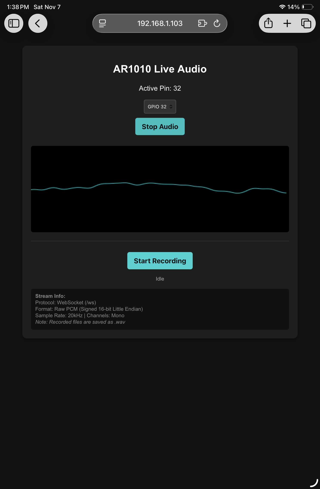
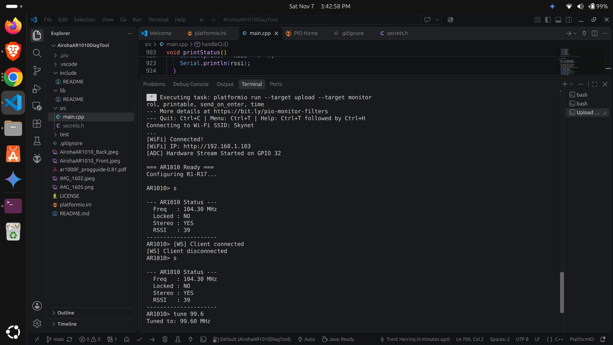

Ré: An FM Radio Streamer and Recorder 📻

Ré is a custom firmware project that connects an ESP32-WROOM board to a vintage SparkFun (2009) Airoha AR1010 FM Radio Receiver Breakout Board. It allows you to control the hardware, stream audio across your local network, and record live radio directly through your web browser.
The system operates both as a hardware serial terminal (CLI) and a lightweight web server hosted concurrently over Wi-Fi.

Below you can see me streaming to my iPad where i can record and save live radio recordings directly to my mobile device!


It is all controlled via a CLI running from a terminal!


⚠️ Hardware Warning

The original SparkFun AIROHA 1010 breakout board is discontinued. If you use an eBay clone, note that they usually require additional wiring adjustments to function with this specific circuit layout.

Features

• AR1010 Control Engine: Handles low-level register configuration over the receiver IC via I2C/SPI to manage tuning frequencies, volume levels, and mute flags.
• Hardware-Driven CLI: Provides an interactive terminal interface directly over the ESP32 serial connection to debug, calibrate, and verify board states.
• Interactive Web Interface: Implements a local web server to serve a control dashboard to any connected device on the Wi-Fi network.
• Dynamic ADC Pin Selection: Includes a dropdown configuration menu in the UI to dynamically switch active ADC paths (such as GPIO 32) for probing individual analog streams.
• In-Browser WAV Recording: Captures raw audio bytes streamed from the ADC natively within the browser, providing direct .wav file downloads.
• Low-Latency WebSocket Engine: Features experimental WebSocket infrastructure designed to stream real-time audio bytes straight from the hardware registers (Note: WebSocket streaming is currently untested).

Hardware Requirements

• 2x 2000 ohm resistors (need to make a voltage divider, 10k is recommended but use whatever you have as long as its 2 of the same value)
• 1x 10uF eletrolytic capacitor
• broadboard with wire, alligator clips, jumper wires (22 AWG should work okay, save 2 1/2 feet for an antenna)
• soldering iron, solder, wire cutter/stripper 
• Microcontroller: ESP32-WROOM (32-bit Dual-Core Tensilica processor)
• FM Receiver Breakout: SparkFun (2009) Airoha AR1010 FM Radio Board
• Visual References: Pin markings can be cross-referenced with the layout photos:
  - 
  - 

Wiring Configuration


Map the connections between your ESP32-WROOM and the breakout pins as follows:

ESP32-WROOM Pin	SparkFun AR1010 Pin	Description
GPIO 21 (SDA)	SDA	I2C Data Line
GPIO 22 (SCL)	SCL	I2C Clock Line
*GPIO 32 (ADC1_CH4)	LEFT or RIGHT AUDIO_OUT	 (input audio signal from 10uF electrolytic capacitor to voltage divider network midpoint with the positive leg of the capacitor tied to the midpoint and the negative end to the audio source, then wire to whatever ADC pin you choose, im using pin 32) See schematic or goto Cirkut Designer file:
https://app.cirkitdesigner.com/project/551769e5-b1a1-470c-9fc6-02ed853b1721
3V3	VCC	3.3V Power Supply
GND	GND	Common Ground Line

Hardware Note: To ensure safe signal processing within the ESP32 internal ADC tolerances (0V - 3.3V), place a protective DC-blocking coupling capacitor inline with the audio path between the receiver output and GPIO 32.

Security & Wi-Fi Configuration

Wi-Fi credentials are kept in a local configuration file ignored by Git to avoid exposing network information publicly.
Before compiling, create a configuration header file named secrets.h inside your include/ directory:
```cpp
// Example layout for your local secrets file
#ifndef SECRETS_H
#define SECRETS_H

const char* WIFI_SSID = "Your_WiFi_Name";
const char* WIFI_PASS = "Your_WiFi_Password";

#endif
```

*Note: Ensure your secret filename matches the layout used in your project and is safely tracked in your `.gitignore` file before making any public forks.*

---
Quick Start & Environment Configuration

This project is built and optimized for compilation using the PlatformIO ecosystem.
1. Clone the Repository Locally:   
```bash
   git clone https://github.com/TangoRomeoEchoNovemberTango/AirohaAR1010DiagTool.git
   cd AirohaAR1010DiagTool
   ```
Use code with caution.
2. Setup Local Credentials:
	• Create your local secrets.h file using the format provided in the Security section above.
3. Open the Environment:
	• Open Visual Studio Code (VS Code) and select the project directory.
	• PlatformIO will parse the platformio.ini specification file and pull down project dependencies automatically.
4. Deploy Firmware:
	• Connect the ESP32-WROOM via USB.
	• Run the PlatformIO Build & Upload target (Ctrl+Alt+U or Cmd+Shift+P -> PlatformIO: Upload).

Software Operation

1. CLI Mode: Open a serial terminal monitor matched to the project's default baud rate to test hardware registers, run diagnostics, and confirm circuit continuity.
2. Web Framework Mode: Monitor the serial output on boot to find the local IP address assigned to the ESP32 by your Wi-Fi access point.
3. Audio Handling: Navigate to that IP inside a web browser, select your active ADC channel via the dropdown interface, and use the recording controls to save your real-time audio streams as archive-ready .wav structures.

Technical Documentation

For precise operational registers, tuning bitmasks, and deep hardware mapping protocols, review the programmatic manual included inside the repository:
👉 [Download/View the Airoha AR1000F Programming Guide (PDF)](ar1000F_progguide-0.81.pdf)

License

This repository is licensed under the terms of the MIT License. See the LICENSE file for more details.
Let me know if you would like me to:
• Document the exact additional wiring steps needed for the eBay clones.
• Add a troubleshooting subsection for Wi-Fi connectivity drops or PlatformIO dependency errors.

